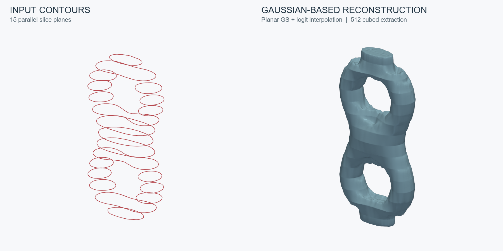
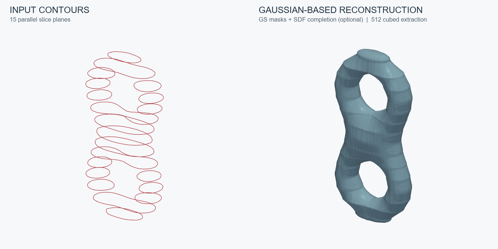
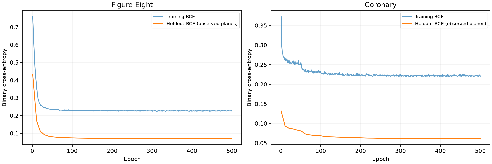

# GaussianSlicer

**Cross-sectional contours → learnable planar Gaussians → triangle meshes.**

An experimental, independent implementation based on *GaussianSlicer: Efficient Surface Reconstruction from Cross-sectional Slices with Gaussian Splatting*. It fits slice occupancy with differentiable Gaussian alpha composition and reconstructs a 3D surface from the learned slices.

This release supports **parallel planes and binary regions**, including nested contour loops. It includes runnable code, two trained examples, full-resolution meshes, checkpoints, inputs, and training histories. Cross-plane aggregation and extraction choices are documented below; this snapshot does not claim to reproduce every component or the numerical results of the paper.

## Results

These images are rendered directly from the included inputs and meshes, with a shared camera and scale within each pair. There is no reference-mesh cropping, geometry smoothing, or image retouching.

### Figure eight · 15 slices



500 epochs · 256 Gaussians per plane · isotropic initialization · planar GS with logit interpolation · 512³ extraction.

[Input](examples/figure_eight/planes.json) · [Mesh](results/figure_eight/mesh.ply) · [Checkpoint](results/figure_eight/model.pt) · [Configuration](results/figure_eight/metadata.json)

Both holes are retained. Slice bands and end-cap artifacts remain visible.

### Coronary structure · 75 slices


500 epochs · 192 Gaussians per plane · anisotropic initialization · planar GS with logit interpolation · 512³ extraction.

[Input](examples/coronary/planes.json) · [Mesh](results/coronary/mesh.ply) · [Checkpoint](results/coronary/model.pt) · [Configuration](results/coronary/metadata.json)

The main structure and branching geometry are recovered, but some thin branches remain disconnected and small floating components remain. These are selected development examples, not an independent test set or a claim of superiority over other methods.

## Installation

Use Python 3.10 or newer. Install PyTorch for your CPU/CUDA environment, then:

```bash
python -m pip install -r requirements.txt
python test_gaussian.py
python test_input.py
```

Training examples were produced on an NVIDIA A100 using Python 3.10 and PyTorch 2.13.0+cu130. Small CPU smoke tests also pass with Python 3.11 and PyTorch 2.11.0+cu128. GPU/library differences can change numerical results; bitwise determinism is not promised.

## Quick start

Generate original synthetic contours and run a small CPU example:

```bash
python example.py --output example_input
python gaussian_slicer.py --planes example_input/planes.json --samples example_input/samples.npz --output example_run --mode linear --device cpu --kernels 16 --epochs 2 --resolution 32 --isotropic-init
python restore_coordinates.py example_run/mesh.ply example_input/transform.json example_run/mesh_world.ply
```

For a full GPU run, replace the small-test settings with `--device cuda --kernels 256 --epochs 500 --resolution 512`. CPU execution at full resolution is slow.

### Reproduce the included examples

The exact prepared sample arrays used for these runs are included:

```bash
python gaussian_slicer.py --planes examples/figure_eight/planes.json --samples examples/figure_eight/samples.npz --output runs/figure_eight --mode linear --kernels 256 --epochs 500 --resolution 512 --isotropic-init --normal-width 1.5 --neighbor-planes 13 --seed 11
python gaussian_slicer.py --planes examples/coronary/planes.json --samples examples/coronary/samples.npz --output runs/coronary --mode linear --kernels 192 --epochs 500 --resolution 512 --seed 11
```

Normal-width and neighbor-plane parameters are recorded for completeness but do not affect `linear` mode. The saved examples were originally extracted at 256³ and then re-extracted at 512³ from the same checkpoints. To re-extract without retraining:

```bash
python extract_gaussian.py --planes examples/figure_eight/planes.json --run results/figure_eight --resolution 512
```

Fresh training outputs `mesh.ply`, `mesh.obj`, `model.pt`, `gaussians.npz`, `history.json`, and `metadata.json`. The committed examples provide PLY meshes, PyTorch state dictionaries, metadata, and histories.

### Use your own contours

```bash
python prepare_input.py contours.csl prepared
# JSON contours are also supported:
# python prepare_input.py contours.json prepared
python gaussian_slicer.py --planes prepared/planes.json --samples prepared/samples.npz --output reconstruction --mode linear --kernels 256 --epochs 500 --resolution 512 --isotropic-init
python restore_coordinates.py reconstruction/mesh.ply prepared/transform.json reconstruction/mesh_world.ply
```

JSON input is a list of plane objects with `origin`, `normal`, and `loops`; each loop contains 3D vertices. Nested loops use even-odd filling. The adapter centers the contour bounding box and scales its longest extent to 1.8. Extraction uses `[-1.1, 1.1]³`, so normalize custom inputs with this adapter. `transform.json` records the inverse transformation. `--keep-coordinates` is only for already normalized data.

The bundled examples already use normalized benchmark coordinates; their meshes and contour JSON files share the same coordinate system.

## What is implemented?

Each planar Gaussian has a learnable center, two covariance scales, an in-plane rotation, and opacity. For one foreground label over a black background, the renderer computes

```text
occupancy(x) = 1 - product_k(1 - opacity_k * gaussian_k(x))
```

This is differentiable alpha composition. All splats have the same label, so the result is independent of ordering. It is not an RGB/camera 3DGS renderer: there are no spherical harmonics, image-view supervision, or CUDA tile rasterizer.

Training uses BCE, cross-plane geometry penalties, and an opacity penalty. Adam starts at 0.001, with learning rate halved every 50 **epochs**. Batches contain up to eight planes, each with 384 off-contour samples and 128 boundary samples. Boundary occupancy is 0.5. Gaussian counts, initialization, neighbor associations, and the interpretation of the paper's steps/epochs wording are implementation choices.

Two field constructions are available:

- **`linear`** — fit planar Gaussian occupancies, interpolate adjacent-plane logits, and add Gaussian end caps. This mode is used in the main examples.
- **`alpha3d`** — extend planar kernels along their normals and alpha-compose nearby-plane contributions. This experimental extension learns normal bandwidths; use `--normal-width` and `--neighbor-planes` to control it. It is not assumed to outperform `linear`.

Both export meshes using marching cubes. Axis-aligned `linear` extraction caches planar evaluations; its values are tested against direct Gaussian evaluation.

### Optional SDF completion

`extract_sdf_completion.py` is a separate **mesh-stage experiment**, not an equation attributed to the paper. It converts learned Gaussian occupancy masks into 2D distance fields, interpolates them, and uses elliptic end caps. It does not retrain the Gaussian model or read a reference mesh.

<details>
<summary>View the figure-eight completion experiment</summary>



[Mesh](results/figure_eight_sdf/mesh.ply) · [Metadata](results/figure_eight_sdf/metadata.json)

```bash
python extract_sdf_completion.py --planes examples/figure_eight/planes.json --run results/figure_eight --output runs/figure_eight_sdf --resolution 512
```

This completion rule changes end caps and interpolation. It still has discretization and slice artifacts and is not used silently in the main examples.

</details>

## Training diagnostics and limits



Holdout points come from the **observed planes**, not unseen slices. Training BCE includes boundary samples with target 0.5; holdout BCE uses off-contour points, so the curves have different sampling distributions. Neither curve certifies correct 3D topology. Recorded timings include concurrent experimentation and different extraction resolutions; they are not a speed benchmark.

See [verification.json](results/verification.json) for the executed tests, checkpoint checks, mesh hashes, and connected-component counts. Small disconnected components are included in these counts and are retained in the downloadable meshes.

Current limitations:

- Parallel planes and one binary foreground label only; no arbitrary non-parallel or multiclass support.
- Fixed Gaussian counts; no clone/split/prune densification.
- Marching cubes instead of the paper's manifold dual contouring.
- Additional cross-plane completion choices rather than a verified reproduction of an unspecified aggregation formula.
- Possible slice bands, end-cap errors, disconnected thin branches, and floating components.

## Data provenance and reference

Figure-eight contours originate from [`eight_15.csl` in OReX](https://github.com/haimsaw/OReX/tree/089db1f757022606399d5f070d65bd172fe69362/Data/csl_with_ref). Coronary contours are a new set of 75 parallel cuts of [`coronary_arteries_v2.stl` from CrossSDF](https://github.com/iamsalvatore/cross_sdf/tree/c962cd2f7ee350cb5b6c78db592814901d1cf23c/data/thin_structures), normalized to longest bounding-box extent 1.8. They are **not the original paper's slice realization**. See [NOTICE](NOTICE).

Method reference: Yuhu Guo, Chenghao Qian, Yuhong Mo, and Akkarit Sangpetch, *GaussianSlicer: Efficient Surface Reconstruction from Cross-sectional Slices with Gaussian Splatting*. No unverified bibliographic details or reported paper performance numbers are assigned to this implementation.

Original implementation code is released under [MIT](LICENSE). Third-party source data and dependencies retain their own rights and terms. No other baseline's source code, private credentials, or paper PDF is included.

To regenerate figures, install `requirements-viz.txt` and run `python tools/render_showcase.py`.
