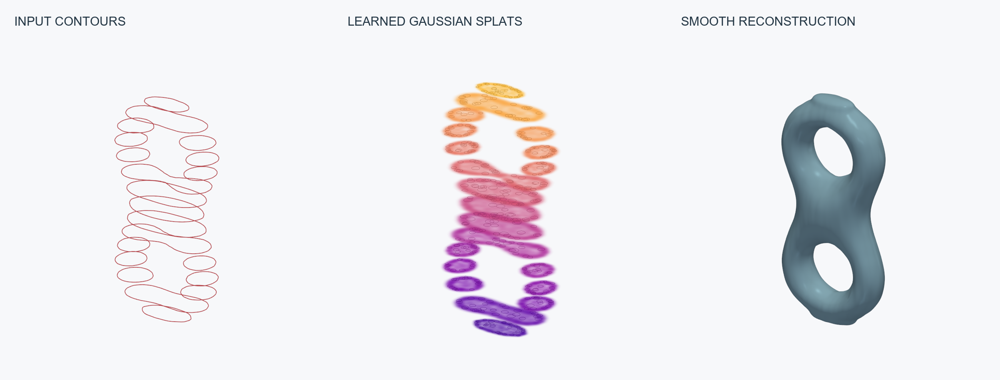
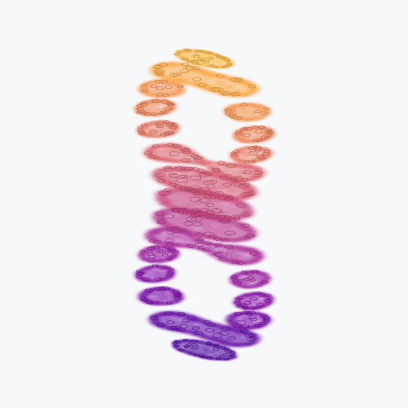
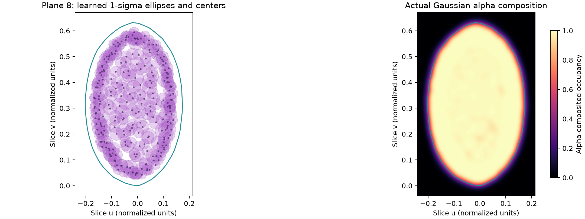
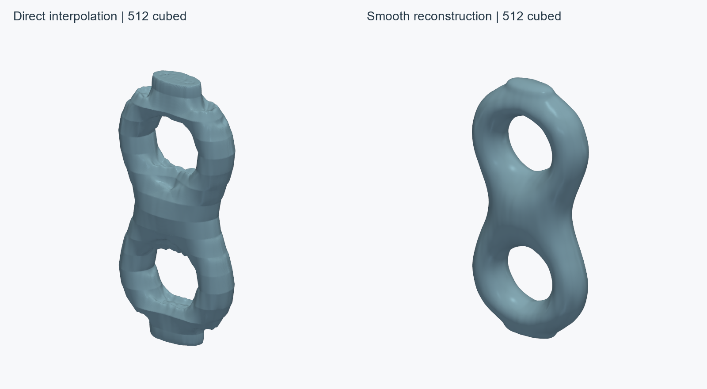
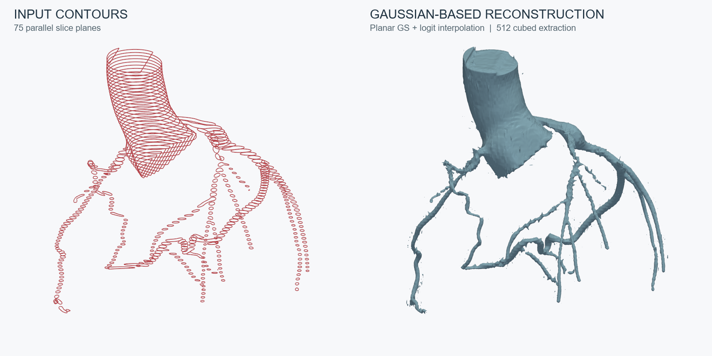

# GaussianSlicer
### Efficient Surface Reconstruction from Cross-sectional Slices with Gaussian Splatting

**ICASSP 2025** · [Paper / DOI](https://doi.org/10.1109/ICASSP49660.2025.10890834) · [BibTeX](CITATION.bib)

[Yuhu Guo](https://anabur920.github.io/)<sup>1,*</sup> ·
[Chenghao Qian](https://jumponthemoon.github.io/)<sup>2,*</sup> ·
Yuhong Mo<sup>1</sup> ·
[Akkarit Sangpetch](https://www.ece.cmu.edu/directory/bios/sangpetch-akkarit.html)<sup>3,4</sup>

<sup>1</sup> Carnegie Mellon University<br>
<sup>2</sup> University of Leeds<br>
<sup>3</sup> CMKL University<br>
<sup>4</sup> School of Engineering, King Mongkut's Institute of Technology Ladkrabang (KMITL)<br>
<sup>*</sup> Equal contribution. Affiliations follow the paper.

**Reconstruct surfaces from cross-sectional contours using learnable planar Gaussian kernels.**



## Gaussian representation

Each kernel learns a center, covariance scales, in-plane rotation, and opacity. The renderer composes their contributions into slice occupancy:

```text
occupancy(x) = 1 - product_k(1 - opacity_k * gaussian_k(x))
```



The visualization uses all **3,840 learned kernels** in the figure-eight checkpoint. Colors encode slice height. For clarity, display alpha is scaled by 0.25 and one-sigma outlines are drawn for every eighth kernel; the training opacities and covariance shapes remain in the checkpoint. [Rendering parameters](assets/splat_visualization.json).



The left panel shows learned centers and one-sigma covariance ellipses on one slice. The right panel evaluates the actual alpha-composited occupancy, with the input contour overlaid.

## Smooth reconstruction



The smooth surface path converts learned planar occupancy into signed-distance fields, uses natural cubic interpolation across slices, applies Gaussian field regularization, and extracts the mesh with marching cubes. The example uses 15 planes, 256 kernels per plane, and a **512³** extraction grid. The scalar-field smoothing scale is **0.012 in normalized coordinates**.

[Smooth mesh](results/figure_eight_smooth/mesh.ply) · [Model](results/figure_eight/model.pt) · [Settings](results/figure_eight_smooth/metadata.json) · [Before/after measurements](results/smoothing_evaluation.json)

The original model and direct logit-interpolation result remain available in [results/figure_eight](results/figure_eight). The showcase uses its 500-epoch checkpoint with smooth surface extraction. Training and extraction changes are measured separately in [the ablation record](results/smoothing_ablation.json).

On this case, the mean symmetric point-to-triangle distance decreased from **0.381% to 0.125%** of the reference bounding-box diagonal (4,000 samples per surface, seed 11). The smooth mesh has one connected component and retains both holes. Input-contour mean distance increased from 0.000372 to 0.000666 in normalized coordinates, reflecting the smoothing tradeoff. These measurements describe this development case.

### Coronary structure · 75 slices



500 epochs · 192 kernels per plane · direct logit interpolation · 512³ extraction. [Input](examples/coronary/planes.json) · [Mesh](results/coronary/mesh.ply) · [Model](results/coronary/model.pt).

## Installation

Python 3.10+ and a PyTorch build matching your CPU/CUDA environment:

```bash
python -m pip install -r requirements.txt
python test_gaussian.py
python test_input.py
```

## Quick start

```bash
python example.py --output example_input
python gaussian_slicer.py --planes example_input/planes.json --samples example_input/samples.npz --output example_run --mode linear --device cpu --kernels 16 --epochs 2 --resolution 32 --isotropic-init
python restore_coordinates.py example_run/mesh.ply example_input/transform.json example_run/mesh_world.ply
```

For GPU training, use `--device cuda` and increase the kernel count, epochs, and resolution.

### Reproduce the smooth figure eight

Using the included checkpoint:

```bash
python extract_sdf_completion.py --planes examples/figure_eight/planes.json --run results/figure_eight --output runs/figure_eight_smooth --resolution 512 --interpolation cubic --smooth-sigma 0.012
```

Train the checkpoint from the included contour samples:

```bash
python gaussian_slicer.py --planes examples/figure_eight/planes.json --samples examples/figure_eight/samples.npz --output runs/figure_eight --mode linear --kernels 256 --epochs 500 --resolution 512 --isotropic-init --normal-width 1.5 --neighbor-planes 13 --seed 11
```

### Smooth-start training

The training schedule gradually removes covariance blur and softens contour labels during the early stage, encourages cross-plane scale consistency, and uses a cosine learning-rate schedule. The final stage uses unblurred kernels and binary off-contour labels.

```bash
python gaussian_slicer.py --planes examples/figure_eight/planes.json --samples examples/figure_eight/samples.npz --output runs/smooth_start --mode linear --kernels 256 --epochs 500 --resolution 512 --isotropic-init --smooth-start --warmup-epochs 200 --blur-start 0.02
```

For gentle refinement of an existing checkpoint, add `--init-model results/figure_eight/model.pt --lr 0.0001 --blur-start 0.006 --warmup-epochs 100`. The showcased surface uses the existing checkpoint plus smooth extraction, which gave the best result among the evaluated settings.

### Your own contours

```bash
python prepare_input.py contours.csl prepared
# JSON input is also supported: python prepare_input.py contours.json prepared
python gaussian_slicer.py --planes prepared/planes.json --samples prepared/samples.npz --output reconstruction --mode linear --kernels 256 --epochs 500 --resolution 512 --isotropic-init
python extract_sdf_completion.py --planes prepared/planes.json --run reconstruction --output reconstruction_smooth --resolution 512 --interpolation cubic --smooth-sigma 0.012
python restore_coordinates.py reconstruction_smooth/mesh.ply prepared/transform.json reconstruction_smooth/mesh_world.ply
```

JSON inputs contain `origin`, `normal`, and `loops` for each plane. Each loop is a list of 3D vertices. Nested contours use even-odd filling. Preparation centers the contours and scales the longest bounding-box extent to 1.8; `transform.json` reverses that normalization.

## Implementation

- **Inputs:** parallel slicing planes and binary foreground regions. The cached smooth surface extractor uses axis-aligned planes.
- **Representation:** learnable planar Gaussian centers, anisotropic covariance, and opacity; fixed kernel count.
- **Training:** occupancy BCE, geometric alignment, and opacity regularization. Smooth-start is selected with a CLI flag.
- **Surface paths:** direct planar-logit interpolation, normal-bandwidth alpha composition (`alpha3d`), or interpolated signed-distance completion.
- **Smooth extraction:** cubic interpolation and scalar-field Gaussian regularization before marching cubes. The smoothing scale is expressed in world-normalized units, independent of grid resolution.
- **Outputs:** PLY/OBJ meshes, model state, Gaussian parameter arrays, histories, and metadata.

Large smoothing scales can reduce thin structures. Slice bands, end-cap errors, or disconnected branches can still occur on challenging inputs. The figures show the actual meshes; no image retouching is applied. The examples are development cases, and reference meshes are used only for post-run evaluation.

## Visualize your kernels

```bash
python -m pip install -r requirements-viz.txt
python tools/visualize_splats.py --run results/figure_eight --planes examples/figure_eight/planes.json --output assets --gain 0.25 --frames 24
python tools/render_showcase.py
```

The splat renderer reads the saved Gaussian parameters directly. It projects covariance matrices into an orthographic camera, evaluates elliptical Gaussian footprints, and performs depth-ordered alpha composition.

## Data and reproducibility

Example contours are derived from [OReX](https://github.com/haimsaw/OReX) and the [CrossSDF dataset](https://github.com/iamsalvatore/cross_sdf). The coronary example uses a newly generated set of 75 parallel slices. Prepared training samples and checkpoints are included. See [NOTICE](NOTICE) for source attribution and [verification](results/verification.json) for the original release checks.

## Citation

If you use this work, please cite:

```bibtex
@INPROCEEDINGS{GaussianSlicer,
  author={Guo, Yuhu and Qian, Chenghao and Mo, Yuhong and Sangpetch, Akkarit},
  booktitle={ICASSP 2025 - 2025 IEEE International Conference on Acoustics, Speech and Signal Processing (ICASSP)},
  title={GaussianSlicer: Efficient Surface Reconstruction from Cross-sectional Slices with Gaussian Splatting},
  year={2025},
  volume={},
  number={},
  pages={1-5},
  keywords={Geometry;Surface reconstruction;Accuracy;Three-dimensional displays;Layout;Signal processing;Topology;Speech processing;Surface treatment;Optimization;Surface reconstruction;cross-section contours;planer gaussian splatting},
  doi={10.1109/ICASSP49660.2025.10890834}
}
```

## License

[MIT License](LICENSE).
